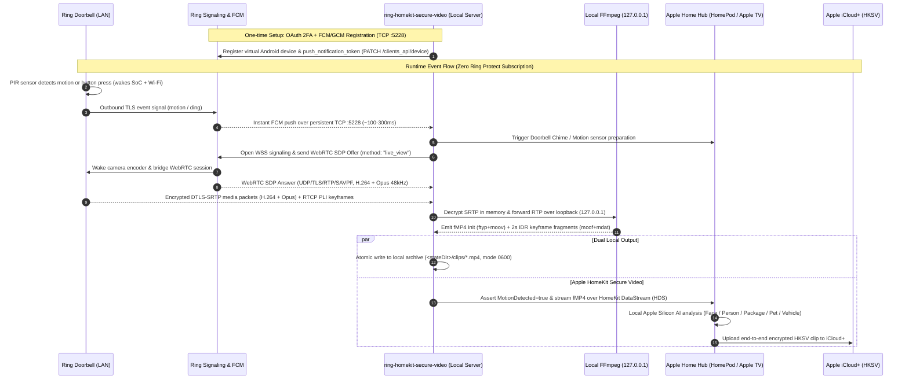

# ring-homekit-secure-video

Self-hosted **Ring Video Doorbell → Apple HomeKit Secure Video (`HKSV` / iCloud+)** bridge, with an optional local clip archive.

Replaces a paid Ring Protect cloud recording subscription by bridging Ring doorbell/camera push events and live WebRTC/RTP media directly to:
1. **Apple HomeKit Secure Video (`HKSV` / iCloud+)** — Your Apple Home Hub (HomePod / Apple TV) receives fragmented MP4 (`fMP4`) streams over HomeKit DataStream (`HDS`), performs local on-device AI detection (people, faces, animals, vehicles, packages), and uploads end-to-end encrypted clips to iCloud+ without counting against your iCloud storage quota.
2. **Optional Local MP4 Clip Archive** (off by default) — When `localClipDumpEnabled` is `true`, also saves timestamped, crash-safe `.mp4` clips (`H.264` + `AAC-LC`) to your local disk with automatic age and storage-cap pruning.
3. **Apple Home Live View & Two-Way Audio** — Full RFC 3711 SRTP/SRTCP (`AES_CM_128_HMAC_SHA1_80`) Live View streaming, Opus `48 kHz` → `16/24 kHz` RTP/RTCP timestamp scaling, seamless `RECONFIGURE` across encoder changes, and authenticated two-way talkback.

---

## Features

- **Zero Ring Subscription Required:** Uses real-time Ring push notifications (`FCM`/`GCM` via `ring-client-api`) + live WebRTC sessions when motion or a doorbell press occurs.
- **HomeKit Secure Video (`CameraRecordingDelegate`):**
  - Compliant `ftyp+moov` initialization segment and keyframe-aligned 2-second `moof+mdat` fragments (`Fmp4StreamSegmenter`).
  - Supports both **Event-Driven Mode** (`alwaysOnPrebuffer: false`, recommended for battery-powered doorbells so they stay in low-power sleep until motion/ding) and **Always-On 4-Second Prebuffer Mode** (`alwaysOnPrebuffer: true`, for hardwired cameras).
  - Enforces HomeKit privacy (`HomeKitCameraActive`) and audio mute (`RecordingAudioActive`) toggles immediately, including mid-stream.
- **Rootless & Hardened:**
  - Runs as an unprivileged user process (`systemd --user` on Linux or standalone Node.js `>= 20` on macOS/Linux).
  - Enforces `0700` state directories and `0600` atomic JSON/clip writes with parent-directory `fsync`.
  - Loopback-isolated FFmpeg SDP sockets (`-localaddr 127.0.0.1`) and RFC 3711 SRTP/SRTCP replay protection before any talkback speaker activation.

---

## Prerequisites

- **Node.js `>= 20`** (the included `./install.sh` automatically installs official Node.js `v22.14.0` in `~/.local/` if Node `>= 20` is not already installed)
- **FFmpeg** (`ffmpeg` and `ffprobe` on `PATH`, e.g. `sudo apt install ffmpeg` or `brew install ffmpeg`)
- **Apple Home Hub** (HomePod, HomePod mini, or Apple TV) on the same LAN and an **iCloud+** plan for HomeKit Secure Video recording

---

## Quick Start

### 1. Clone & Install

```bash
git clone https://github.com/anubhavmalhotra/ring-homekit-secure-video.git
cd ring-homekit-secure-video
chmod +x install.sh
./install.sh
```

On Linux with `systemd`, `./install.sh` installs dependencies, runs the unit + real-FFmpeg E2E test suite, installs and starts the rootless `~/.config/systemd/user/ring-hksv.service` unit, and prints your Apple Home QR code and 8-digit Setup Code.

*(Tip: To keep `systemd --user` services running after logout/reboot on Linux, ensure lingering is enabled once via `loginctl enable-linger $USER`.)*

### 2. Authenticate Your Ring Account (One-Time 2FA)

```bash
npm run auth
```

Enter your Ring email, password, and 2FA verification code (or pass an existing refresh token via `RING_REFRESH_TOKEN` or `--stdin`). The CLI verifies that `FCM`/`GCM` push receiver credentials are registered and durably persisted (`0600`) in `~/.local/share/ring-hksv/config.json`.

If running under `systemd --user`, restart the service after authenticating:

```bash
systemctl --user restart ring-hksv.service
```

### 3. Pair with Apple Home

```bash
npm run pair-info
```

1. Open the **Apple Home** app on iPhone/iPad → tap **+** → **Add Accessory**.
2. Scan the QR code printed by `npm run pair-info` (or tap **More Options…**, select **Ring Doorbell**, and enter the 8-digit Setup Code).
3. In Apple Home → **Ring Doorbell** settings → **Recording Options**, set **When Home** and **When Away** to **Stream & Allow Recording**.

---

## Configuration

Configuration is stored in `~/.local/share/ring-hksv/config.json` (override the directory with `--state-dir /path` or `RING_HKSV_STATE_DIR=/path`):

| Field | Default | Description |
|---|---|---|
| `accessoryName` | `"Ring Doorbell"` | Accessory name shown in Apple Home |
| `bindAddress` | Auto-detected LAN IPv4 | Local interface IPv4 address for HomeKit mDNS & HAP server |
| `hapPort` | `21065` | TCP port for the HomeKit accessory server |
| `alwaysOnPrebuffer` | `true` | Maintain a continuous 4s prebuffer when HKSV is active (`set to false` for battery-powered doorbells) |
| `localClipDumpEnabled` | `false` | Also save every motion/doorbell clip to `<stateDir>/clips/*.mp4` (by default clips only go to iCloud+ via HKSV) |
| `eventDurationSeconds` | `25` | Hold duration (seconds) after motion/ding trigger |
| `clipRetentionDays` | `10` | Maximum age (days) for local `.mp4` clips |
| `maxClipsTotalBytes` | `5368709120` (5 GiB) | Maximum total disk usage for local `.mp4` clips |
| `ffmpegPath` | Auto-detected | Path to `ffmpeg` binary |
| `targetCameraId` | `null` (auto-select) | Optional specific Ring camera/doorbell device ID |
| `targetCameraName` | `null` (auto-select) | Optional specific Ring camera/doorbell name |

---

## CLI Commands

```bash
# Show live daemon status and recent local MP4 clips
npm run status

# Display Apple Home setup code, setup URI, and terminal QR code
npm run pair-info

# Authenticate with Ring (interactive 2FA or token input)
npm run auth

# Trigger a synthetic doorbell/motion event on a running daemon (sends SIGUSR1)
npm run test-event

# Run the unit and real-FFmpeg E2E test suite
npm test
```

---

## Reverse-Engineering Findings, Hardware Security & Step-by-Step Protocol Flow

### 1. Why Direct LAN Interception & Custom Firmware Fail on Ring Hardware

A natural question when replacing a cloud camera subscription is: *"Can we block the Ring doorbell from reaching Amazon on the local router, redirect its outbound traffic to a local server, or patch the firmware to stream directly to our own backend?"*

Reverse-engineering the network behavior and hardware architecture of modern Ring Video Doorbells reveals four layers of defense that prevent LAN MITM interception and unsigned firmware modification:

1. **Zero Local Listening Ports (No RTSP / ONVIF / Local HTTP):**
   - Full TCP/UDP port scans of Ring doorbells on the local LAN show **zero open TCP listening ports** (no RTSP `:554`, no ONVIF, no local WebSocket or HTTP server).
   - Battery-powered models keep their main SoC and Wi-Fi radio powered down in deep sleep (`< 100 µA`) while a dedicated ultra-low-power Passive Infrared (`PIR`) microcontroller monitors motion and the physical button. The Wi-Fi radio only wakes up to initiate **outbound** connections when triggered.
2. **Strict TLS Certificate Pinning & Mutual TLS (`mTLS`):**
   - When the doorbell wakes up, it establishes outbound TLS 1.2/1.3 control sessions to Ring/Amazon endpoints (`*.ring.com`, `*.rings.solutions`, `*.kinesisvideo.*.amazonaws.com`) and encrypts all media using WebRTC `DTLS-SRTP` (`UDP/TLS/RTP/SAVPF`).
   - The embedded TLS client pins Amazon's Root CA / intermediate Subject Public Key Info (`SPKI`) hashes in firmware and authenticates the hardware unit using a factory-provisioned, per-device client certificate.
   - If a local router/firewall redirects DNS or `iptables` traffic to a local server, the doorbell's TLS stack immediately aborts the handshake (`BAD_CERTIFICATE` / `UNKNOWN_CA`) before a single frame of video or motion metadata is transmitted.
3. **SoC Hardware Root of Trust (Boot ROM + OTP eFuses):**
   - Ring doorbells enforce a cryptographic **Secure Boot chain** anchored in silicon:
     - **Immutable Mask ROM & OTP eFuses:** On power-up, the SoC executes immutable Boot ROM code burned into silicon at manufacture. It reads the SHA-256 hash of Ring's root RSA/ECDSA public signing key from One-Time-Programmable (`OTP`) hardware **eFuses**.
     - **Verified Boot Chain (`Boot ROM → First-Stage Bootloader → U-Boot/FIT Kernel → SquashFS/dm-verity`):** Each boot stage cryptographically verifies the digital signature of the next stage before jumping to it. The Linux kernel mounts a signed, read-only root filesystem containing the camera daemon and pinned CA bundle.
     - **Signed & Encrypted OTA Firmware:** Firmware updates are verified against the hardware root of trust prior to flashing. Modifying even a single byte of the flash image (for example, replacing an Amazon URL or injecting a local root CA) invalidates the RSA/ECDSA signature and causes the SoC to halt boot.
4. **Hardware Lockout on Production PCBs:**
   - Production units blow debug-disable eFuses to lock out JTAG/SWD interfaces, disable interactive U-Boot/UART root shells, and store per-device identity keys in flash regions encrypted by a hardware-unique key (`HUK`) inside the SoC.

---

### 2. Why TLS Pinning Does Not Defeat `ring-homekit-secure-video` (or `ring-mqtt` / Scrypted)

Tools like **`ring-mqtt`**, **Scrypted**, **`ring-client-api`**, and **`ring-homekit-secure-video`** do **not** attempt to MITM the connection between the doorbell and Amazon (`Doorbell ↛ Fake Server`).

Instead, they operate on the **client side of Ring's signaling architecture** — impersonating an authenticated **Ring Android mobile app** (`Doorbell ↔ Ring Signaling ↔ Local Bridge → Apple Home Hub → iCloud+`).

Crucially, **Ring's paywall only restricts cloud recording storage (`Ring Protect`)**. Real-time push notifications (motion and doorbell press alerts) and on-demand **Live View** WebRTC streaming are **free baseline hardware features** that work without any subscription. By instantaneously turning every free push notification into a programmatic Live View stream, the local bridge captures the live audio/video feed in real time and hands it to your Apple Home Hub (`HomeKit Secure Video` / iCloud+), and to local disk if the optional clip archive is enabled.

---

### 3. Step-by-Step Operation (How `ring-mqtt` & `ring-homekit-secure-video` Capture Video Without a Ring Plan)



#### Detailed Step-by-Step Breakdown

1. **Step 1 — Virtual Android Push Registration (`FCM` / `GCM` on TCP `:5228`):**
   - During `npm run auth`, the bridge exchanges your Ring credentials + 2FA code for an OAuth refresh token (`oauth.ring.com/oauth/token`) bound to a virtual `hardware_id`.
   - It then registers a virtual Android push client (`@eneris/push-receiver`) with Google's Firebase Cloud Messaging (`FCM` / `GCM`) using Ring's Android application sender ID, obtains an `fcm.token`, and sends `PATCH https://api.ring.com/clients_api/device` with `push_notification_token`.
   - At runtime, the daemon holds a persistent outbound TLS connection to `mtalk.google.com:5228`, waiting for push messages with zero polling delay.

2. **Step 2 — Hardware PIR Wakeup & Sub-Second Push Delivery:**
   - When someone approaches your door or presses the button, the doorbell's PIR sensor wakes the SoC and Wi-Fi radio.
   - The doorbell notifies Ring's backend over its pinned TLS channel. Even without a Ring Protect plan, Ring immediately dispatches a push notification (`com.ring.push.HANDLE_NEW_MOTION` or `com.ring.push.HANDLE_NEW_DING`) to all registered devices on your account.
   - Your local `ring-homekit-secure-video` daemon receives that push packet over its persistent `:5228` socket within ~100–300 ms.

3. **Step 3 — Programmatic WebRTC `live_view` Negotiation:**
   - The instant the push packet arrives, `ring-homekit-secure-video` initiates a WebRTC `live_view` call — the exact same API call the Ring smartphone app makes when you tap "Live View":
     - Connects to `wss://api.prod.signalling.ring.devices.a2z.com:443/ws` using a single-use signaling ticket.
     - Generates a WebRTC SDP offer (`werift` `RTCPeerConnection`) requesting `video/H264` (`90 kHz`) and `audio/opus` (`48 kHz`, 2 channels) or `PCMU`, and sends `method: "live_view"`.
     - Ring's signaling service forwards the live-view request to the already-awake doorbell and returns the SDP answer (`UDP/TLS/RTP/SAVPF`) along with ICE candidates and DTLS fingerprints.

4. **Step 4 — In-Memory `DTLS-SRTP` Decryption & Loopback FFmpeg Pipeline:**
   - `werift` completes the ICE/DTLS handshake, decrypts incoming `SRTP` video (`H.264`) and audio (`Opus`) packets in memory, and sends RTCP Picture Loss Indication (`PLI`) packets every 4 seconds (and immediately upon attachment) so the doorbell emits clean H.264 IDR keyframes.
   - Decrypted RTP packets are forwarded strictly over loopback (`127.0.0.1`) to a local `ffmpeg` child process bound with `-localaddr 127.0.0.1`.
   - `ffmpeg` transcodes/repackages the stream into an Apple-compliant **fragmented MP4 (`fMP4`)** byte stream (`-movflags frag_keyframe+empty_moov+default_base_moof+omit_tfhd_offset`) with forced 2-second H.264 IDR keyframes and `AAC-LC` audio.

5. **Step 5 — Simultaneous Local `.mp4` Archive & Apple HomeKit Secure Video (`iCloud+`) Upload:**
   - `Fmp4StreamSegmenter` parses the stdout byte stream into the ISO BMFF initialization segment (`ftyp + moov`) and individual 2-second media fragments (`moof + mdat`).
   - **Local Archive (`LocalClipRecorder`):** Immediately writes `ftyp + moov` and every `moof + mdat` fragment to a `.part` file (`0600`), calls `fsync`, and atomically renames it to `<stateDir>/clips/<timestamp>_<motion|ding>_<nonce>.mp4` when the event finishes.
   - **Apple HomeKit Secure Video (`CameraRecordingDelegate`):** Once the initialization segment and first keyframe fragment are ready, the bridge asserts `MotionDetected = true` on the HomeKit accessory (`:21065`). Your Apple Home Hub (HomePod or Apple TV) opens a HomeKit DataStream (`HDS`) session, pulls the prebuffered `ftyp + moov` and subsequent `moof + mdat` fragments over your LAN, runs local Apple Silicon smart detection (People, Familiar Faces, Packages, Animals, Vehicles), sends rich snapshot notifications to your iPhone/iPad/Apple Watch/Apple TV, and uploads the end-to-end encrypted clip to **iCloud+**.

---

## License

MIT
